# Domain model

The clinic's data: doctors publish slots, patients (or receptionists for them) book appointments in slots, and doctors write visit notes on appointments. These entities become the API schemas.

```mermaid
erDiagram
    DOCTOR ||--o{ SLOT : publishes
    DOCTOR ||--o{ APPOINTMENT : attends
    PATIENT ||--o{ APPOINTMENT : books
    SLOT ||--o| APPOINTMENT : "held by one active"
    APPOINTMENT ||--o{ VISIT_NOTE : has
    DOCTOR ||--o{ VISIT_NOTE : writes

    DOCTOR {
        string id PK
        string userSub "sign-in subject"
        string name
    }
    PATIENT {
        string id PK
        string userSub "null when registered by reception"
        string name
        string phone
    }
    SLOT {
        string id PK
        string doctorId FK
        datetime startsAt
        datetime endsAt
        string status "open | booked"
    }
    APPOINTMENT {
        string id PK
        string slotId FK
        string patientId FK
        string doctorId FK
        datetime startsAt
        datetime endsAt
        string status "booked | cancelled | checked-in"
        datetime checkedInAt
    }
    VISIT_NOTE {
        string id PK
        string appointmentId FK
        string authorDoctorId FK
        string text
        datetime createdAt
        datetime updatedAt
    }
```

A doctor or patient record is linked to the signed-in subject on first use (assumed). A slot holds at most one active appointment; cancelling reopens the slot. Visit notes are exposed to doctors only.
