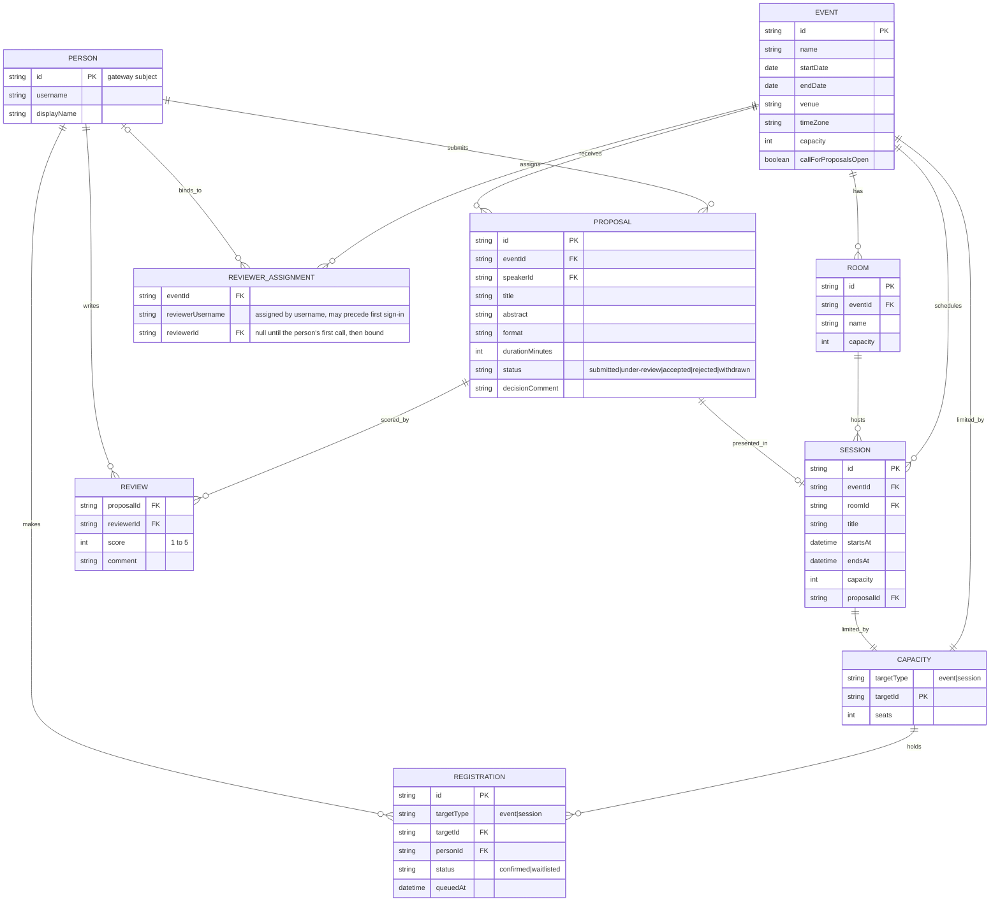

# Domain model

Events, sessions and rooms, talk proposals with their reviews, and registrations with a waitlist. The events API owns everything except `Registration` and `Capacity`, which belong to the registration service (P3).

`Person` is filled from the gateway's signed assertion the first time someone calls the events API. A reviewer assignment is stored against a username; on that person's first call it binds to their `Person` id, and queue and score checks match on username or id. A waitlist position is derived from `queuedAt` order among waitlisted registrations of one target.
