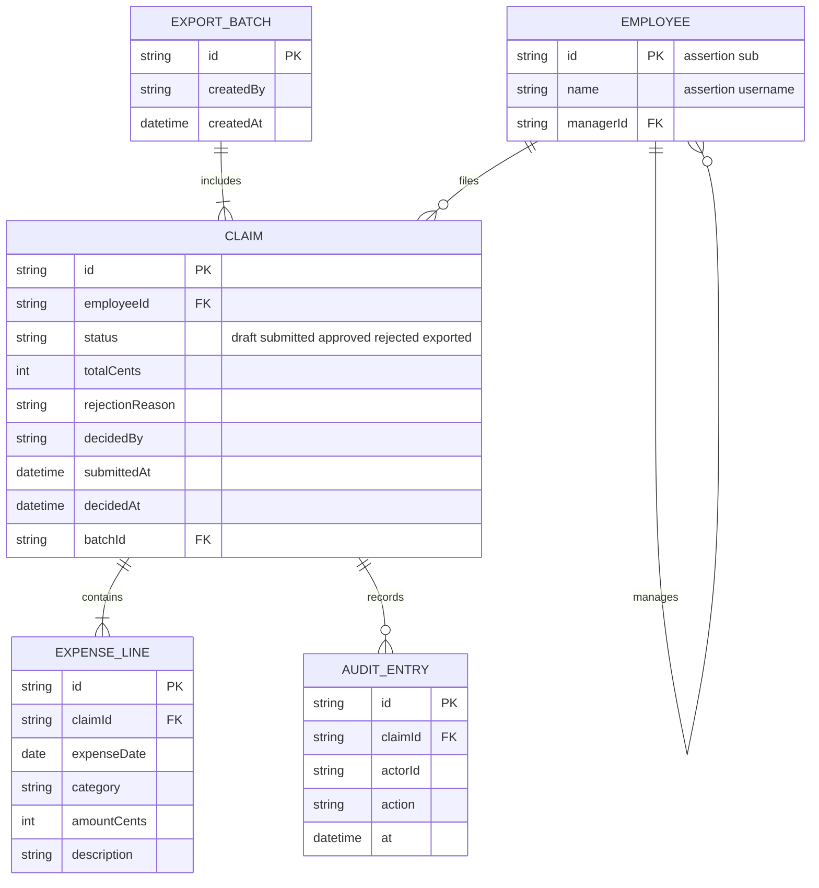

# Domain model

Employees file claims made of expense lines; their manager decides; finance groups approved claims into export batches. Amounts are integer cents in one company currency (P3).

Categories are a fixed list served by the API. An employee record is created by the API itself: on every authenticated request it upserts an employee with `id` = the gateway assertion's `sub` and `name` = its username, and the web app calls `GET /me` at startup so each person is recorded on first open. The manager relation (`managerId`) is set by finance through the API, choosing from every recorded employee; it is not taken from the sign-in directory.
