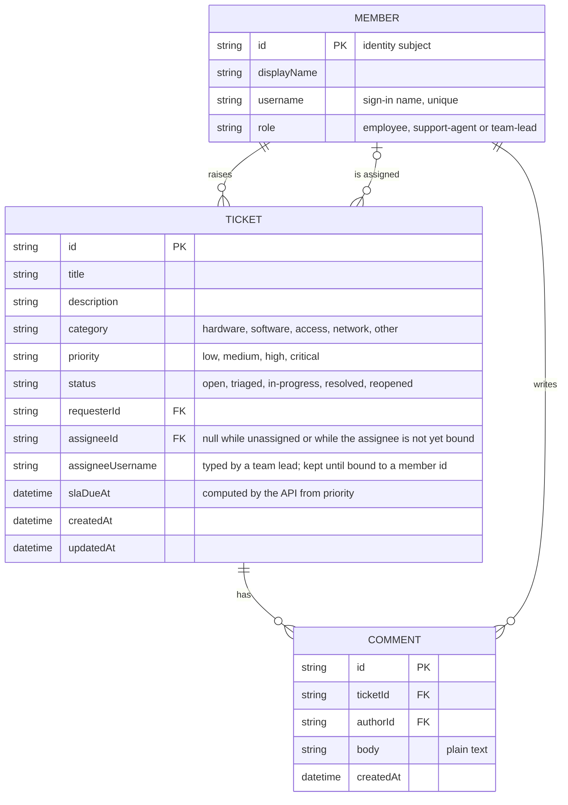

# Domain model

The help desk revolves around tickets raised by employees, worked by support agents, and discussed in a comment thread. Members are the people the API has seen sign in.

- SLA hours by priority (assumed): critical 4, high 8, medium 24, low 72; `slaDueAt` is creation time plus these hours and is recomputed when the priority changes.
- `slaBreached` is not stored: it is true when `slaDueAt` has passed and the status is not resolved, evaluated whenever tickets are read.
- A team lead may assign by member id or by typed username. An unseen username is accepted: the ticket keeps `assigneeUsername` with no `assigneeId`, and on that person's first authenticated call the API creates their member record and sets `assigneeId` and the display name.
- Names (requester, assignee, author) are filled from the API's own member records, never from client input.
