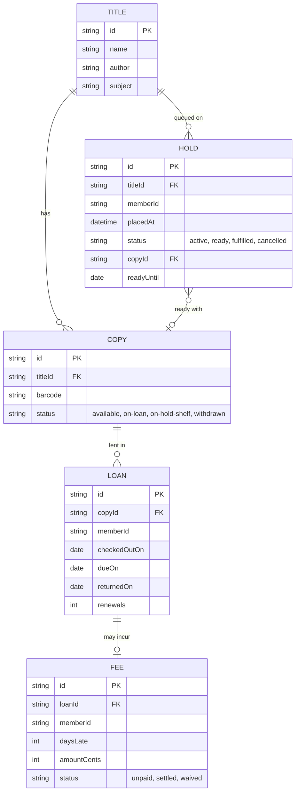

# Domain model

Titles and copies belong to the catalogue service; loans, holds and fees belong to the circulation API. Members are the signed-in people and are identified by their sign-in subject, so there is no member table.

- A loan is overdue when it is open and `dueOn` is past; this is derived on read.
- Fee amount is 25 minor units per day late, capped at 1000 per loan.
- A hold's queue position is derived from `placedAt` among active holds on the title.
