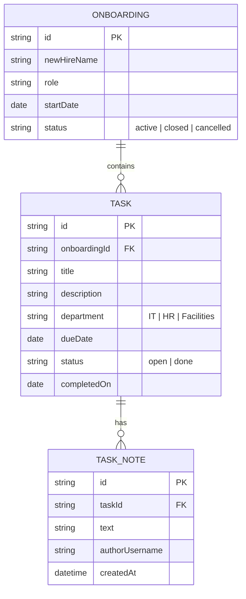

# Domain model

An onboarding tracks one new hire's checklist of tasks, each owned by a department (IT, HR or Facilities). Overdue and due-soon flags are computed from the due date, not stored.

- Progress, per-department done/open counts, overdue and due-soon are derived from tasks and today's date.
- A new onboarding is seeded with the default task set, with due dates as offsets from the start date.
- A caller's department is not stored: the API derives it from which department scopes (`tasks:*-it`, `-hr`, `-facilities`) the gateway assertion carries; the assertion holds sub, username and scope only, never groups.
