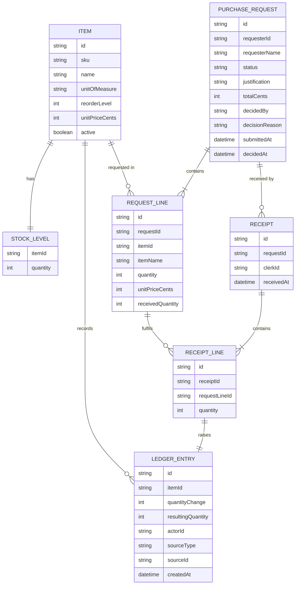

# Domain model

Requests, approvals and receipts belong to the procurement API; items, stock levels and the ledger belong to the inventory service. Requests reference items by id only.

Approval limits are configuration, not an entity: every Approver has APPROVAL_LIMIT_DEFAULT (500000 minor units, i.e. 5000.00, when unset), with optional per-username overrides in APPROVAL_LIMITS (username=amount pairs). There is no screen to manage them. Money is in cents in the company currency. Status values: draft, pending, approved, rejected, withdrawn, received.
