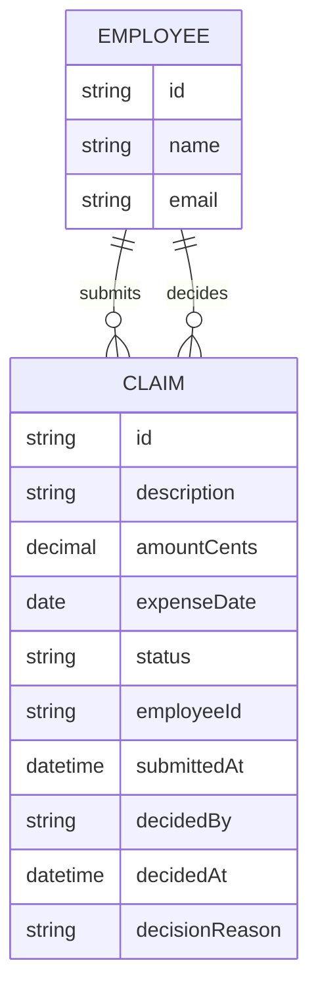

# Data model

An Employee submits Claims; an Approver decides each one. A claim's status and
decision reason are on the claim itself, never in a separate record.

- `EMPLOYEE` is any signed-in person — the identity the gateway asserts, not a
  record this app seeds; its `id` is the caller's identity subject.
- `CLAIM.status` is one of `submitted`, `approved`, `rejected` (product-wide
  decision — no draft state, no multi-step chain).
- `decidedBy`, `decidedAt` and `decisionReason` are set once, at the decision,
  and never change afterwards (a decision is final).
- `amountCents` stores the amount in whole cents to avoid floating-point
  rounding; it must be greater than zero. `expenseDate` cannot be in the future.
