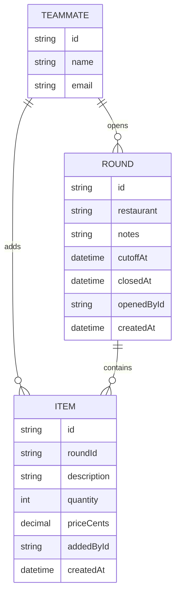

# Data model

A lunch round belongs to the one shared team; it is opened by a teammate for a
restaurant with a cutoff, and teammates add their own items to it until it
closes.

- `TEAMMATE` is derived from the signed-in identity (Google Workspace via
  Thunder); nothing creates it explicitly.
- A `ROUND` is open while `closedAt` is unset and `cutoffAt` is in the future;
  it is closed once either passes. `closedAt` is set when the opener closes it
  early, or by the cutoff check once `cutoffAt` passes.
- `ITEM.priceCents` stores the price in cents, typed by the teammate who added
  it (F2 decisions).
