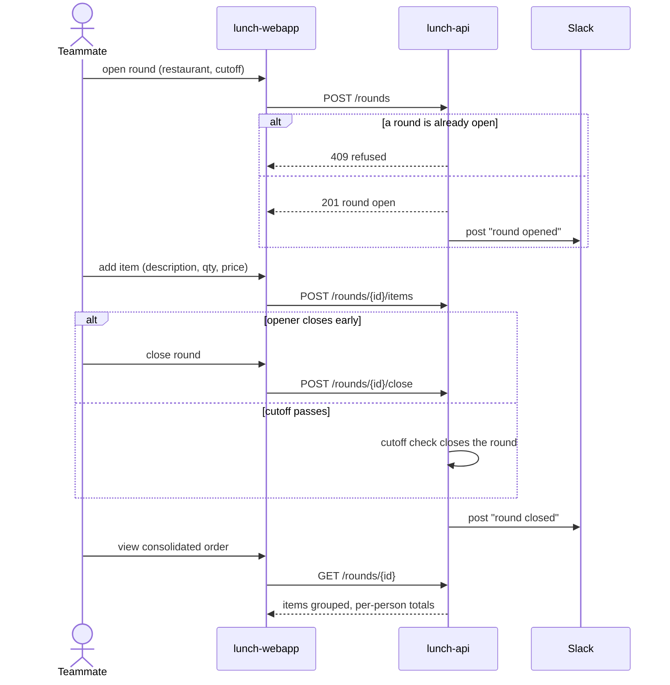

# A round's lifecycle, from opening to the consolidated order

A teammate opens today's round, the team adds items, and the round closes —
either the opener closes it early or its cutoff passes — after which the
opener gets the consolidated order. Slack hears about the open and the close.

